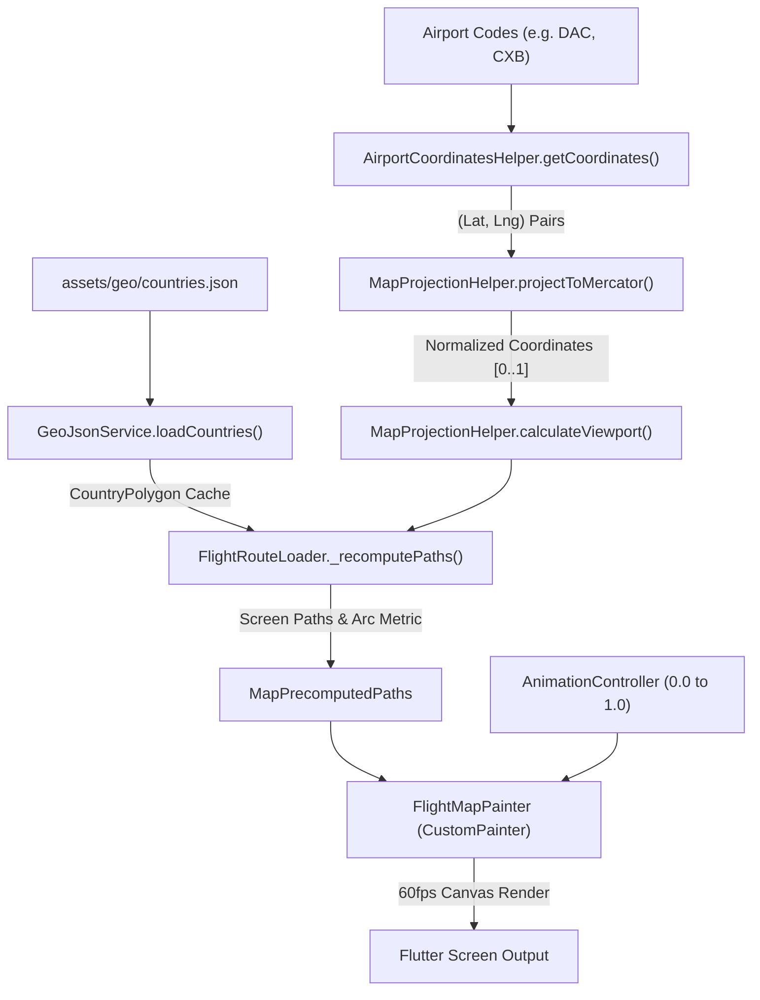

# Flight Map Route Loader — Architecture & Porting Guide

A high-performance, offline vector map loading widget for Flutter that draws an animated flight trajectory across a lightweight world map with adaptive camera zoom, collision-safe airport cards, and tangent-aligned airplane motion.

---

## Table of Contents
1. [Overview & Visual Features](#1-overview--visual-features)
2. [Architecture & Data Flow](#2-architecture--data-flow)
3. [Mathematical & Algorithmic Foundations](#3-mathematical--algorithmic-foundations)
   - [Web Mercator Projection](#web-mercator-projection)
   - [Adaptive Viewport Scaling (Distance-Based Zoom)](#adaptive-viewport-scaling-distance-based-zoom)
   - [Flight Trajectory Bezier Arc](#flight-trajectory-bezier-arc)
   - [Airplane Heading & Tangent Angle](#airplane-heading--tangent-angle)
   - [Collision-Aware Card Placement](#collision-aware-card-placement)
   - [Multi-Tier Airport Coordinate Resolution](#multi-tier-airport-coordinate-resolution)
4. [File Inventory & Directory Structure](#4-file-inventory--directory-structure)
5. [Dependencies & Assets](#5-dependencies--assets)
6. [Vanilla Flutter Porting Guide](#6-vanilla-flutter-porting-guide)
7. [Ready-to-Use Code Snippets](#7-ready-to-use-code-snippets)
8. [Theming & Customization Options](#8-theming--customization-options)

---

## 1. Overview & Visual Features

- **Offline Vector Landmasses**: Built from a bundled, lightweight (~110m) Natural Earth GeoJSON dataset (`assets/geo/countries.json`), requiring zero external tile servers or internet connection.
- **Adaptive Camera Zoom**:
  - Automatically zooms in close for short domestic hops (e.g., DAC ⇄ CXB, JFK ⇄ BOS, LHR ⇄ MAN) with generous margins so country boundaries fill the screen.
  - Smoothly pulls back for intercontinental flights (e.g., DAC ⇄ JFK, LHR ⇄ SIN) to show the full hemisphere or globe.
- **Flight Trajectory Arc & Tangent Plane**: A quadratic Bezier curve that arches gracefully between endpoints. An airplane icon traverses the curve at 60fps, rotating continuously to match the path's exact tangent angle.
- **Collision-Free Airport Cards**: Floating IATA cards with city names dynamically arrange themselves above/below pins and clamp within screen margins to eliminate text collisions on short hops.
- **Precomputed 60fps Performance**: Geographic polygon projection and path conversions are calculated once when canvas dimensions or coordinates change. The paint loop only executes path extraction and translation/rotation transforms.

---

## 2. Architecture & Data Flow



---

## 3. Mathematical & Algorithmic Foundations

### Web Mercator Projection
Converts spherical Earth coordinates $(\text{lat}, \text{lng})$ in degrees to normalized Cartesian space $[0.0, 1.0]$:

$$\text{clampedLat} = \text{clamp}(\text{lat}, -85.05112878, 85.05112878)$$
$$x = \frac{\text{lng} + 180^\circ}{360^\circ}$$
$$y = 0.5 - \frac{\ln\left(\tan\left(\frac{\pi}{4} + \frac{\text{radLat}}{2}\right)\right)}{2\pi} = 0.5 - \frac{\ln\left(\frac{1 + \sin(\text{radLat})}{1 - \sin(\text{radLat})}\right)}{4\pi}$$

```dart
static Offset projectToMercator(double lat, double lng) {
  final clampedLat = lat.clamp(-85.05112878, 85.05112878);
  final clampedLng = lng.clamp(-180.0, 180.0);

  final double x = (clampedLng + 180.0) / 360.0;
  final double radLat = clampedLat * math.pi / 180.0;
  final double sinLat = math.sin(radLat);
  final double y = 0.5 - math.log((1.0 + sinLat) / (1.0 - sinLat)) / (4.0 * math.pi);

  return Offset(x, y.clamp(0.0, 1.0));
}
```

---

### Adaptive Viewport Scaling (Distance-Based Zoom)
To make domestic flights look great without over-zooming beyond vector fidelity, the viewport span adapts dynamically based on normalized Euclidean distance:

$$d = \sqrt{(x_1 - x_2)^2 + (y_1 - y_2)^2}$$

$$\text{adaptiveMinSpan} = \begin{cases} 
0.016 & d < 0.005 \quad (\approx 5.7^\circ \text{ super-short}) \\
0.016 + \frac{d}{0.025}(0.032 - 0.016) & 0.005 \le d < 0.025 \quad (\text{domestic hops}) \\
0.032 + \frac{d - 0.025}{0.055}(0.065 - 0.032) & 0.025 \le d < 0.080 \quad (\text{regional routes}) \\
0.070 & d \ge 0.080 \quad (\text{intercontinental})
\end{cases}$$

```dart
final double scaleX = canvasSize.width / spanX;
final double scaleY = canvasSize.height / spanY;
double scale = math.min(scaleX, scaleY).clamp(canvasSize.width / 0.98, canvasSize.width / 0.015);
```

---

### Flight Trajectory Bezier Arc
The flight path is a quadratic Bezier curve bulging perpendicular to the chord connecting start and end points:

1. Chord vector: $\vec{\Delta} = \mathbf{P}_{\text{end}} - \mathbf{P}_{\text{start}}$
2. Perpendicular unit normal vector:
   $$\vec{N} = \left(-\frac{\Delta_y}{\|\vec{\Delta}\|}, \frac{\Delta_x}{\|\vec{\Delta}\|}\right)$$
   Flip $\vec{N}$ if $N_y > 0$ so the arc arches upward (negative canvas Y).
3. Dynamic bow height:
   $$\text{bowHeight} = \text{clamp}(\|\vec{\Delta}\| \times 0.22, 18.0, 56.0)$$
4. Control point:
   $$\mathbf{P}_{\text{control}} = \frac{\mathbf{P}_{\text{start}} + \mathbf{P}_{\text{end}}}{2} + \vec{N} \cdot \text{bowHeight} + (0, -4.0)$$

---

### Airplane Heading & Tangent Angle
Using Flutter's `PathMetric`, the airplane's translation and heading rotation are derived with zero trigonometry in the paint loop:

```dart
final PathMetric metric = data.arcMetric;
final double currentDistance = metric.length * arcFraction;
final Tangent? tangent = metric.getTangentForOffset(currentDistance);

if (tangent != null) {
  canvas.save();
  canvas.translate(tangent.position.dx, tangent.position.dy);
  canvas.rotate(tangent.vector.direction); // Direction angle in radians (-pi to +pi)
  _drawPlaneIcon(canvas, brandColor);
  canvas.restore();
}
```

---

### Collision-Aware Card Placement
To prevent origin and destination cards from overlapping on short-haul flights:

- **North-South Flights** ($|\Delta y| \ge 25\text{px}$):
  - Northern point (smaller $y$) places its card **ABOVE** its dot.
  - Southern point (larger $y$) places its card **BELOW** its dot.
  - Both cards point **away** from the center, making collision mathematically impossible.
- **East-West Flights** ($|\Delta y| < 25\text{px}$):
  - Origin places card **ABOVE**; destination places card **BELOW**.
- **Margin Clamping**:
  ```dart
  final double cardLeft = (point.dx - cardWidth / 2.0).clamp(10.0, canvasSize.width - cardWidth - 10.0);
  final double cardTop = rawCardTop.clamp(68.0, canvasSize.height - cardHeight - 80.0);
  ```

---

### Multi-Tier Airport Coordinate Resolution
`AirportCoordinatesHelper.getCoordinates(code, {country, countryCode, fallbackLat, fallbackLng})` resolves coordinates through 6 fallback layers:

1. **Direct Explicit Coordinates**: If `fallbackLat`/`fallbackLng` are already provided.
2. **High-Precision Hub Table**: Instant $O(1)$ coordinates for Bangladesh & international global hubs.
3. **In-Memory Cache**: Queries `AirportService` for parsed database/API coordinates.
4. **FAA 3-Character Pattern**: Detects US strip codes (e.g., `00J`, `14Y`, `3A1`).
5. **Static Country Centroids**: Comprehensive global table covering ~240 countries/territories by ISO code and full name.
6. **Dynamic Vector Centroid**: Calculates bounding-box centroid directly from `GeoJsonService.getCountryCentroid(query)` using `assets/geo/countries.json`.
7. **Deterministic Dispersion**: Spreads unknown airports within the same country by $\pm 1.8^\circ$ lat and $\pm 2.5^\circ$ lng using `code.hashCode` so domestic routes never collapse into a single point.

---

## 4. File Inventory & Directory Structure

To port this module to another app, copy these files into your target project:

```
lib/
├── helper/
│   └── airport_coordinates_helper.dart  # Multi-tier fallback & country centroids
├── services/
│   ├── geo_json_service.dart            # GeoJSON parser & polygon caching
│   └── airport_service.dart             # (Optional) Airport data & search
└── widgets/map_loader/
    ├── map_projection_helper.dart       # Mercator math, adaptive zoom, Bezier arc
    ├── flight_map_painter.dart          # 60fps CustomPainter & canvas drawing
    └── flight_route_loader.dart         # Main UI widget & animation controller
assets/
└── geo/
    └── countries.json                   # Natural Earth 110m low-res world boundaries
```

---

## 5. Dependencies & Assets

Add the following to your target `pubspec.yaml`:

```yaml
dependencies:
  flutter:
    sdk: flutter
  flight_world_loading: ^0.0.2

flutter:
  assets:
    - assets/geo/countries.json
```

---

## 6. Vanilla Flutter Porting Guide

If your target app does **not** use `GetX`, `easy_localization`, or `flutter_screenutil`, make these 3 minor replacements:

### 1. Remove `flutter_screenutil`
In `flight_route_loader.dart`, replace `.w`, `.h`, `.sp`, `.r` extensions with standard numbers:
- Replace `16.w` $\to$ `16.0`
- Replace `50.h` $\to$ `50.0`
- Replace `14.sp` $\to$ `14.0`

### 2. Remove `easy_localization`
Replace `ez.tr("Live fares")` with plain strings:
```dart
final List<String> steps = widget.stepLabels ?? const [
  "Searching live fares",
  "Checking routes & layovers",
  "Finding best prices",
  "Finalizing options",
];
```

### 3. Remove `GetX`
In `flight_route_loader.dart`:
- Replace `Get.put(FlightSearchLoaderController())` with a local `ValueNotifier<int>` or `Timer.periodic`.
- Replace `Get.isDarkMode` with `Theme.of(context).brightness == Brightness.dark`.

---

## 7. Ready-to-Use Code Snippets

### Standard Full-Screen Invocation
```dart
import 'package:flutter/material.dart';
import 'widgets/map_loader/flight_route_loader.dart';

void openFlightLoader(BuildContext context) {
  Navigator.push(
    context,
    MaterialPageRoute(
      builder: (context) => const FlightRouteLoader(
        fromCode: 'DAC',
        fromCity: 'Dhaka',
        fromLat: 23.8433,
        fromLng: 90.3978,
        toCode: 'CXB',
        toCity: "Cox's Bazar",
        toLat: 21.4522,
        toLng: 91.9639,
        brandColor: Color(0xFF1F4A3F), // Forest green or brand theme
      ),
    ),
  );
}
```

### Async Search Integration with Auto-Dismiss
```dart
Future<void> runSearchFlow(BuildContext context) async {
  // 1. Show the animated loader
  Navigator.push(
    context,
    MaterialPageRoute(
      builder: (context) => FlightRouteLoader(
        fromCode: 'DAC',
        fromCity: 'Dhaka',
        fromLat: 23.8433,
        fromLng: 90.3978,
        toCode: 'JFK',
        toCity: 'New York',
        toLat: 40.6413,
        toLng: -73.7781,
        onCancel: () => Navigator.pop(context),
      ),
    ),
  );

  // 2. Run API search in parallel with minimum animation duration
  try {
    final results = await Future.wait([
      fetchFlightFaresFromApi(),
      Future.delayed(const Duration(milliseconds: 3500)), // Prevents screen flash
    ]);

    // 3. Navigate to results screen
    if (context.mounted) {
      Navigator.pushReplacement(
        context,
        MaterialPageRoute(builder: (context) => ResultsScreen(data: results.first)),
      );
    }
  } catch (error) {
    if (context.mounted) Navigator.pop(context);
    showErrorDialog(context, error.toString());
  }
}
```

---

## 8. Theming & Customization Options

| Property | Type | Default | Description |
|---|---|---|---|
| `fromCode` | `String` | *(Required)* | 3-letter IATA code (e.g. `'DAC'`, `'JFK'`) |
| `fromCity` | `String` | *(Required)* | City name displayed on top card |
| `fromLat` / `fromLng` | `double` | *(Required)* | Origin latitude & longitude |
| `toCode` | `String` | *(Required)* | Destination IATA code |
| `toCity` | `String` | *(Required)* | Destination city name |
| `toLat` / `toLng` | `double` | *(Required)* | Destination latitude & longitude |
| `brandColor` | `Color` | `Color(0xFF1F4A3F)` | Color of route arc, plane, pins, and IATA codes |
| `stepLabels` | `List<String>?`| 4 flight search steps | Custom cycling search status messages |
| `subtitle` | `String?` | `'ROUND TRIP • 1 PASSENGER'` | Header subtitle pill text |
| `onCancel` | `VoidCallback?`| `Navigator.pop(context)` | Cancel button callback |

### Palette Tokens Used
- **Water Background**:
  - Light mode: `#E2EBE7` (Soft botanical mist wash)
  - Dark mode: `#131A18` (Deep forest midnight)
- **Landmass Fill**:
  - Light mode: `#FAF7F1` (Warm organic parchment paper)
  - Dark mode: `#1E2824` (Muted spruce slate)
- **Landmass Borders**:
  - Light mode: `#E5DECF` (Muted line stroke)
  - Dark mode: `#2C3B36` (Subtle boundary stroke)
- **Trajectory Arc**:
  - `brandColor` with dynamic alpha fade and 5.0px soft glow shadow